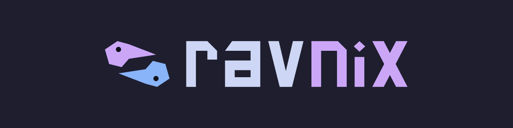
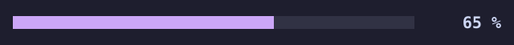
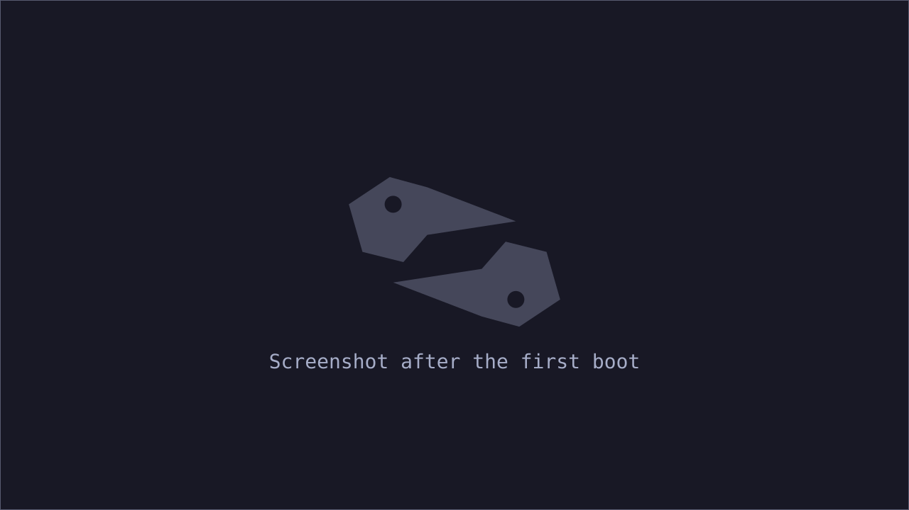
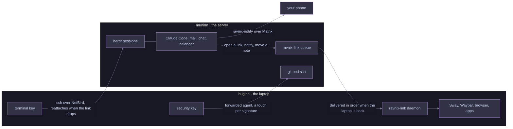

# 

**Two machines, one system.** Ravnix is a NixOS flake that splits your
computer in two. The laptop, `huginn`, runs the desktop and the graphical
applications. The server, `muninn`, runs your terminal sessions, so they keep
working when the lid closes, the train enters a tunnel, or the battery dies.
One key on the laptop opens them again, right where you left them. Both hosts
are built from the same modules, so the shell, the tools and the look are the
same on each.

The flake holds no personal values. You keep yours in a private flake of your
own that imports this one, starting from the template in `templates/default/`.

## 📈 Status

Not ready to install yet. The figure is the share of steps done in the
authors' own build plan, and it moves by hand when that plan is recounted.

- **Done:** the foundation (the repository, the gate, the typed options, the
  private-flake template), and the modules both hosts share (shell, git, the CLI tools, the theme, Neovim, Claude Code and
  its MCP servers).
- **Under way:** the laptop (disk guard, desktop, applications, power; the
  first install is next), the server (the workbench and its images), the glue
  between them, keeping Claude Code current, and the shared dictionary.
- **Not started:** public versions of the agent skills, self-hosted services
  as modules, quick settings in Odin, performance baselines, the full docs,
  Odin ports of the carried-over scripts, and the switch from the authors'
  current setup.

## 🐦‍⬛ The name

In Norse myth, Odin keeps two ravens, Huginn and Muninn, thought and memory.
They fly out over the world every morning and tell him what they saw every
evening. Here the laptop is where you think and look, and the server
remembers. The tools ravnix writes for itself are written in Odin, the
programming language.

## 🔗 How it fits together

The terminal key opens a ghostty on the laptop that attaches to herdr on the
server. What a session on the server wants from the desktop, such as opening
a link, showing a notification or moving a note in Obsidian, goes through
`ravnix-link`, and waits in a queue while the laptop is away. Git and ssh on
the server reach the git hosts with the security key in the laptop, so each
of those connections needs a touch from someone sitting there.

## 🧰 What you get

- A Sway desktop on the laptop: Waybar, fuzzel, dunst, swaylock, kanshi and
  greetd, all in one Catppuccin Mocha theme with the accent you pick.
- Terminal sessions on the server in herdr, with Claude Code, mail in aerc,
  chat in iamb, a calendar in khal, the toolchains and Podman.
- Claude Code kept current on both hosts: each new release is checked against
  Anthropic's manifest, and the running sessions move onto it without losing
  their work.
- One dictionary of your own words, synced with every tool that keeps a word
  list.
- Secrets read from Bitwarden through `rbw` when they are needed, and stored
  in neither repository.
- The server as a NixOS host, a Proxmox image or an OCI image.
- A disk layout and install steps that touch only the disk your configuration
  names, by model and serial, checked by a guard before anything is written.

## 🧭 Principles

- **Nothing personal in this repository.** Every personal value is a typed
  option that your private flake sets, and a check against a deny list runs on
  every commit and every commit message.
- **New tools are written in Odin**, and each comes with tests that hunt for
  edge cases and a callgrind gate that fails when its instruction count rises
  more than 2 %.
- **No CI, a strict gate instead.** The git hooks run the fast checks on every
  commit and all of them before every push.
- **One look.** Square corners, one accent, color only for state, no
  animation. [The style guide](docs/style.md) has the rules and the reasons.

## 🛠️ Tools

| Tool | What it does |
| --- | --- |
| [`ravnix-disk-guard`](tools/ravnix-disk-guard) | Picks the one disk an installer may write, by model and serial, and refuses when there is not exactly one |
| [`ravnix-link`](tools/ravnix-link) | Carries what the server wants from the desktop to the laptop, queued while it is away |
| [`ravnix-notify`](tools/ravnix-notify) | Posts a message to the Matrix room of a topic, so it reaches your phone with the lid closed |
| [`ravnix-dict`](tools/ravnix-dict) | Keeps one dictionary of custom words and feeds it to every tool that has a word list |
| [`claude-code-verify`](tools/claude-code-verify) | Proves that a Claude Code binary is the one Anthropic released |
| [`claude-roll`](tools/claude-roll) | Moves the Claude Code sessions in herdr onto the newly installed version without ending their work |

## 📚 Read on

- [Install Nix on another distribution](docs/install-from-another-distro.md):
  evaluate and build the flake on a machine that does not run NixOS yet.
- [Style](docs/style.md): how ravnix looks, and the checklist for styling
  anything new.
- [Brand](docs/brand/README.md): the raven mark and which file to use where.
- [AGENTS.md](AGENTS.md): the rules for AI agents working in this repository.

## ⚖️ License

[AGPL-3.0-or-later](LICENSE). The authors are listed in [AUTHORS](AUTHORS).
